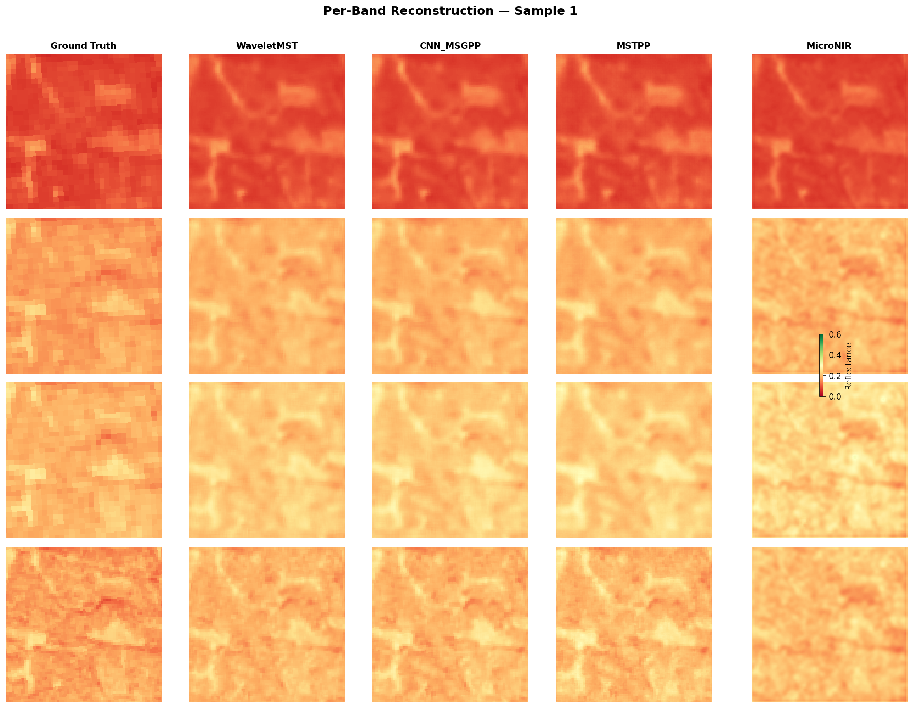
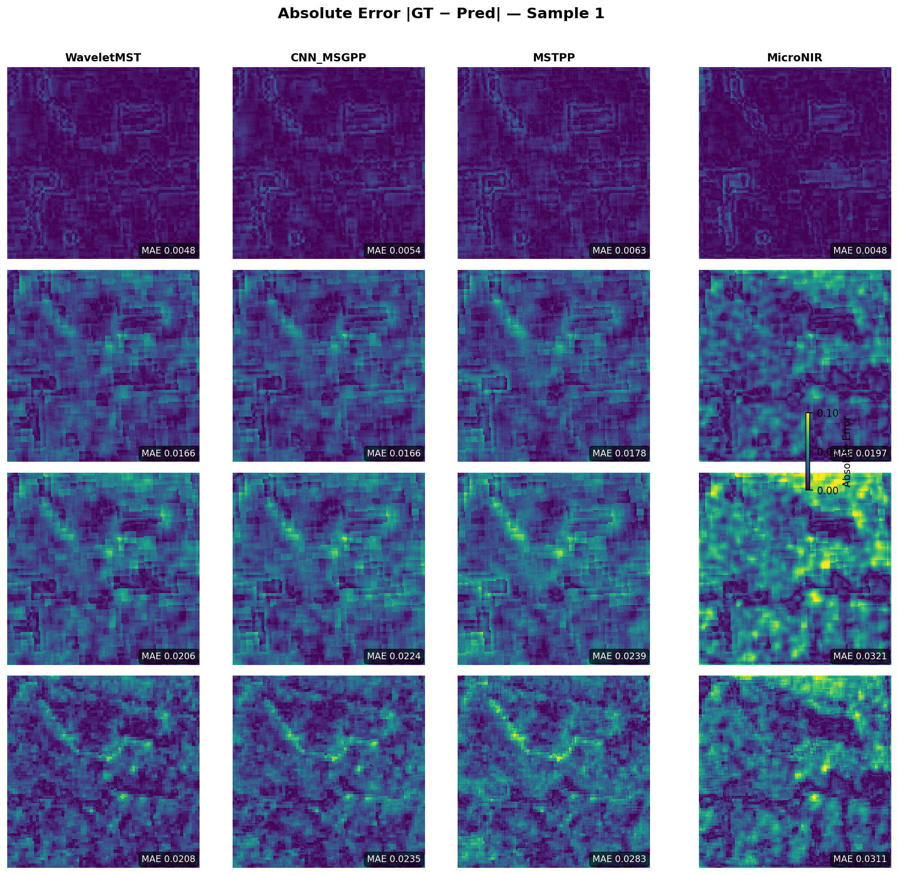
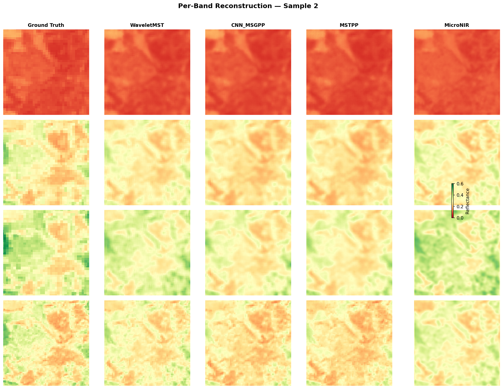
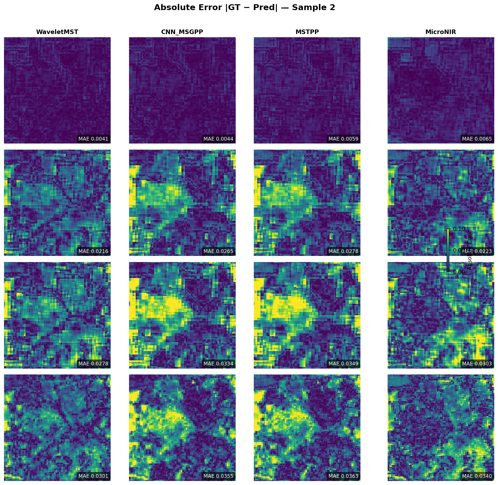

# NIR Generation from RGB

Predict Sentinel-2 NIR / Red-Edge bands (B5–B8) from RGB (B2/B3/B4), in TensorFlow.

Side project for my Master's. NDVI and NDRE need a NIR band that plain RGB doesn't have, so I trained a model to predict it from RGB. It's trained on Sentinel-2 forest patches and each split has their own regions. Its Sentinel-2 so it's all at 10 m/pixel which means it works for satellites but not on drone or phone photos so it might be interessting to look if these models works on these spatial resolution too.

## Structure

```text
.
├── README.md
├── LICENSE
├── requirements.txt
├── .gitignore
├── images/
│
├── src/
│   ├── data/data_loader.py
│   ├── models/
│   │   ├── micronir.py
│   │   ├── waveletmst.py
│   │   ├── cnn_msgpp.py
│   │   └── mstpp.py
│   └── training/
│       ├── losses.py
│       └── trainer.py
│
├── train.py
├── evaluate.py
├── run_pipeline.sh                    Two-phase training (L1+SAM, then + freq/wavelet)
│
├── scripts/
│   ├── get_data.py                    Sentinel-2 patch export (Earth Engine -> GCS)
│   ├── verify_tfrecord.py             Colab-only
│   ├── check_tfrecord.py              Colab-only
│   ├── verify_params.py
│   └── smoke_test.py
│
└── notebooks/                         Original Colab notebooks
    ├── Train_MicroNIR.ipynb
    ├── Train_WaveletMST.ipynb
    ├── Train_CNN_MSGPP_Decoder_L1_SAM.ipynb
    ├── Train_MSTPP_New.ipynb
    └── Compare_Models.ipynb           Source of the benchmark numbers
```

`train.py` / `evaluate.py` / `src/` are the cleaned-up version. The notebooks in `notebooks/` are the actual Colab runs.

## Data

`scripts/get_data.py` exports Sentinel-2 surface reflectance patches from Google Earth Engine to GCS as TFRecords. Each example has the 7 bands as `VarLenFeature(float32)` plus a `valid` mask:

- `B2, B3, B4`: Blue, Green, Red (input)
- `B5, B6, B7, B8`: Red-Edge 1, 2, 3, NIR (target)
- `valid`: per-pixel mask (1 = use, 0 = skip)

Patches are ~129×129 from GEE, crop-padded to 128×128. Reflectance values divided by 10 000 and clipped to [0, 1]. Inputs stacked as `[B4, B3, B2]`, targets as `[B5, B6, B7, B8]`. The mask propagates through the loss.

Train and test regions are geographically disjoint — the test set is never seen during training, so it's a real generalization check.

| Split | Regions |
| --- | --- |
| Train (12) | Amazonia, Congo, SE Asia, Central America, India, Western Europe, North America, China/Japan, South America temperate, Siberia, Canada, Eastern Australia |
| Test (4) | New Zealand, Scandinavia, Madagascar, Tasmania |

## Trained models

Four architectures, same training recipe (L1 + SAM loss, AdamW, warmup + cosine LR).

### MicroNIR - 130,852 params

Mobile-style backbone: 6 inverted-residual blocks (expansion 2, GELU, RMSNorm, DropPath 0.1), squeeze-and-excitation, and a global RGB→NIR 1×1 projection that the rest of the network refines residually. The cheap baseline.

### WaveletMST - 1,049,398 params

Two branches: a 2-level Haar DWT and a shallow conv. Concat, project to 112, then 5 spectral transformer blocks with multi-head attention over channels (8 heads, Q/K-normed). CBAM in the decoder, residual head. Explicit frequency decomp helps a bit, not as much as expected.

### CNN_MSGPP - 982,500 params

CNN stem (64 then 112), 4 MSGPP blocks. Each block: depthwise 7×7 spatial mix (expansion 2), 8-head spectral attention, pointwise MLP (expansion 4). RMSNorm throughout, global residual at the head. Best of the four on every metric.

### MSTPP - 1,721,110 params

TF port of MST++ (Cai et al., CVPRW 2022) at the paper's structural config: embedding 28, 3 SST stages, `[2,2,2]` SAB blocks per level, heads `[1,2,4]`, FFN expansion 2.66. SAB = spectral self-attention + gated-DConv FFN. Two deliberate deviations from the reference, both for stability at the paper's tiny dim: a fixed `1/seq_len` attention scale instead of a learned per-head temperature, and a 0.1 residual scale on the attention and FFN branches (carried over from the original notebook). It probably needed a longer training run than I could afford so that's likely part of why it is not as good as my CNN_MSGPP in the results below.

## Train

```bash
python train.py --model_name MicroNIR \
                --train_data gs://YOUR_BUCKET/dataset_training_mst/train/*.tfrecord.gz
```

`--model_name` takes any of `MicroNIR`, `WaveletMST`, `CNN_MSGPP`, `MSTPP`. Pass `--mixed_precision` on L4. Without `--val_data`, the loader splits 10% off `--train_data`.

Two-phase recipe (L1+SAM first, then fine-tune with freq + wavelet):

```bash
bash run_pipeline.sh MicroNIR     # uses $TRAIN_DATA and $VAL_DATA from env
```

## Results

```bash
python evaluate.py --model_name CNN_MSGPP \
                   --weights checkpoints/best.weights.h5 \
                   --test_data gs://YOUR_BUCKET/dataset_training_mst/test/*.tfrecord.gz
```

### Overall metrics

| Model | MAE | RMSE | SAM (rad) | SID | NDVI MAE | NDRE MAE |
| --- | ---: | ---: | ---: | ---: | ---: | ---: |
| **CNN_MSGPP** | **0.0211** | **0.0316** | **0.0517** | **0.0128** | **0.0279** | **0.0484** |
| MSTPP | 0.0225 | 0.0341 | 0.0547 | 0.0171 | 0.0304 | 0.0522 |
| WaveletMST | 0.0234 | 0.0355 | 0.0549 | 0.0176 | 0.0310 | 0.0522 |
| MicroNIR | 0.0287 | 0.0429 | 0.0669 | 0.0229 | 0.0390 | 0.0658 |

### Per-band MAE

| Model | B5 (RE1) | B6 (RE2) | B7 (RE3) | B8 (NIR) |
| --- | ---: | ---: | ---: | ---: |
| **CNN_MSGPP** | **0.0065** | **0.0208** | **0.0274** | **0.0296** |
| MSTPP | 0.0073 | 0.0223 | 0.0289 | 0.0315 |
| WaveletMST | 0.0072 | 0.0233 | 0.0302 | 0.0328 |
| MicroNIR | 0.0102 | 0.0281 | 0.0356 | 0.0411 |

## Samples







Two more pairs in [`images/`](images/).

## Setup

Python ≥ 3.10. GPU helps (training was on Colab L4).

```bash
pip install -r requirements.txt
python scripts/smoke_test.py     # checks the pipeline works end-to-end on dummy data
python scripts/verify_params.py  # checks all 4 trained models build with the right param count
```

## Limits

- Training set is forest patches only, so reflectance predictions outside vegetation are likely off.
- Validation split is regions used during training; the test regions above are the only real generalization test.
- Heavier image-restoration backbones (NAFNet, Restormer, RCAN) would be the natural next thing to try with more compute.

## References

- Cai, Yuanhao, et al. "MST++: Multi-Stage Spectral-Wise Transformer for Efficient Spectral Reconstruction." CVPRW 2022. <https://doi.org/10.1109/CVPRW56347.2022.00090>
- Fujieda, Shin, Kohei Takayama, and Toshiya Hachisuka. "Wavelet Convolutional Neural Networks." arXiv:1805.08620. <https://doi.org/10.48550/arXiv.1805.08620>
